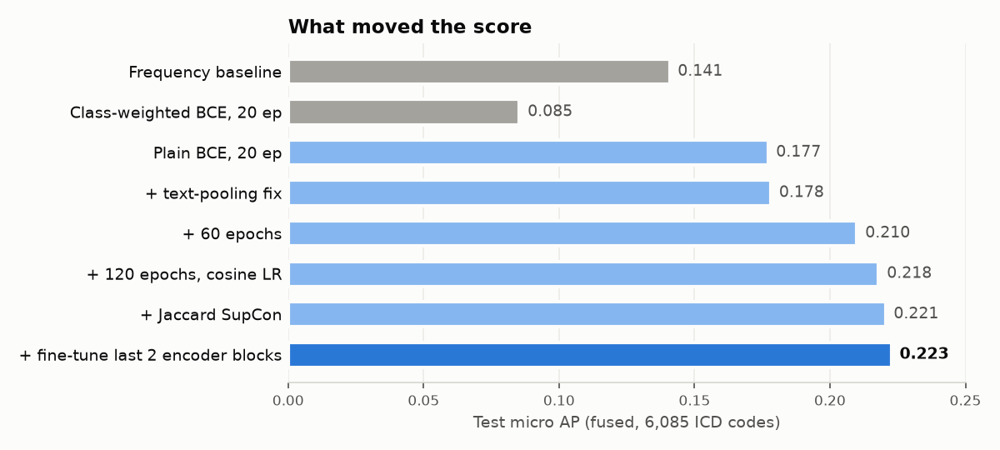

# Task 2 — Multimodal ICD coding from chest X-rays and radiology reports

Predict the full set of **ICD codes** of a hospital admission (multi-label, **6,085 codes**) from the admission's
**chest X-rays** and **radiology reports** (MIMIC-IV linked to MIMIC-CXR).

📄 [Final report (PDF)](docs/task2_final_report.pdf) · 🖥️ [Slides](docs/task2_presentation.pptx) ·
📓 [Results notebook](notebooks/results_overview.ipynb) · 🔁 [Full reproduction guide](docs/REPRODUCE.md)

## Method

```
X-ray images ─► DINOv3 ViT-S/16 (frozen) ─► MLP projection ─┐
                                                             ├─► fusion ─► shared linear classifier ─► 6,085 code scores
Reports ──────► MedCLIP text tower (frozen) ─► MLP projection┘
```

* Studies are encoded once and averaged per admission; only the projection, fusion and classifier are trained.
* Loss: `0.25·BCE_img + 0.25·BCE_txt + 0.5·BCE_fused + λ·SupCon`, where the supervised contrastive term pulls
  admissions together in proportion to the **Jaccard overlap of their code sets** (λ = 0.001).
* Final step: fine-tune the last 2 blocks of both encoders, starting from the best frozen-encoder model.
* Data: official patient-disjoint split, admissions with ≥ 1 image: **8,610 / 1,293 / 2,016** (train / val / test).

## Results



| Model (test set, fused scores) | micro AP | P@5 | retrieval Jaccard@10 |
|---|---|---|---|
| Frequency baseline | 0.141 | 0.361 | 0.044 (random) |
| BCE, 120 epochs, cosine LR (3 seeds) | 0.2180 ± 0.0003 | 0.430 | 0.069 |
| + Jaccard SupCon (3 seeds) | **0.2205 ± 0.0004** | 0.437 | 0.070 |
| Hierarchy-weighted SupCon instead (seed 42) | 0.2200 | 0.435 | 0.070 |
| Jaccard SupCon + encoder fine-tuning (seed 42) | **0.2227** | 0.441 | 0.072 |

**Key findings**

1. **The basics mattered most.** Plain instead of class-weighted BCE, a fix for MedCLIP's pooling (it averaged
   padding tokens) and training to convergence took AP from 0.085 to 0.218.
2. **Label-aware contrastive learning helps a little but consistently:** +0.0025 AP on 3/3 seeds, with better
   retrieval of similar admissions. Weighting pairs by the ICD hierarchy adds nothing.
3. **Fine-tuning the encoders gives another +0.0025** (image and text gains add up).
4. **The ceiling (~0.22 AP) comes from the inputs.** Only about 7–11 % of positive labels are diagnoses a chest
   X-ray can show (the model reaches 2.7× the baseline on them), while about 79 % have no direct radiological sign
   (1.4×). Coarse ICD levels are far easier (chapter-level AP 0.67).

## Quick start

Requires credentialed MIMIC-IV / MIMIC-CXR access, a GPU with ≥ 12 GB and Python 3.12. All paths (data, Python,
pretrained weights, Slurm options) live in **`configs/paths.env`**.

```bash
cd src/task2
pip install -r requirements.txt            # after installing torch 2.6 / torchvision 0.21
bash setup_weights.sh                      # or point configs/paths.env to existing weights
source configs/paths.env

sbatch $SBATCH_ARGS slurm/quick_test.sbatch          # ~2 min end-to-end check → "QUICK TEST PASSED"
bash slurm/reproduce_all.sh                          # all experiments, chained with dependencies
$PYTHON -m experiments.compare_with_shipped          # compare your runs with results/
```

Every job is also a plain `python -m experiments.<name>` command; see [docs/REPRODUCE.md](docs/REPRODUCE.md).

## Repository layout

```
configs/      shared hyper-parameters + paths.env (the only file to edit)
experiments/  all code: model, training, evaluation, retrieval, diagnostics (experiment01.py = core library)
slurm/        job scripts, one submit script per round, reproduce_all.sh, quick_test.sbatch
results/      metrics of every reported run (results.json, retrieval.json, config.json) + diagnostics
notebooks/    results_overview.ipynb: documented tables and figures, reads only results/
docs/         final report, slides, reproduction guide
```

Model checkpoints, feature caches and per-patient predictions are not included: they are large, and the MIMIC
data-use agreement does not allow sharing patient-level data.
